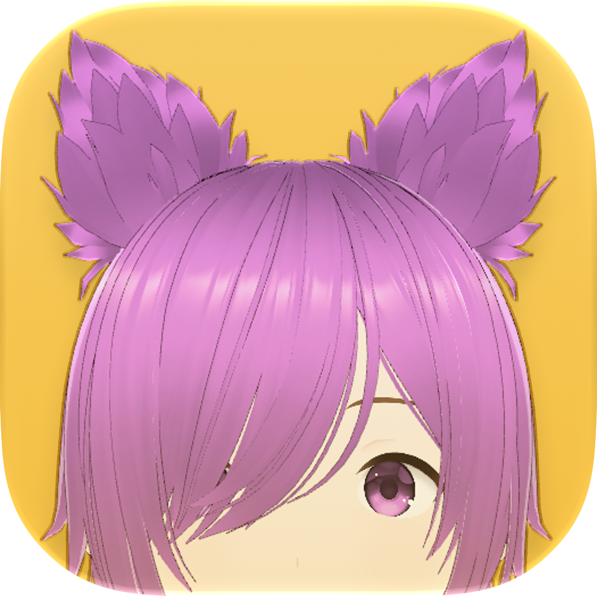
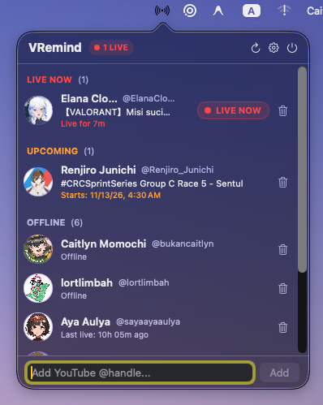

# VRemind

<p align="center">
  
</p>

<p align="center">
  <a href="https://apple.com"></a>
  <a href="https://swift.org"></a>
  
  <a href="LICENSE"></a>
  <a href="#running-tests"></a>
</p>

A native macOS 12.0+ (Monterey and newer) menu bar VTuber stream reminder coded 100% in Swift with SwiftUI and AppKit, featuring zero third-party dependencies.

> [!NOTE]
> **Maintenance Mode:** With [`VRemindCore`](https://github.com/momochisoundpost/VRemindCore) and `VRemind` now cleanly separated, **VRemind is entering maintenance mode** — future updates will focus on syncing `VRemindCore` and fixing upstream breakage (mostly because YouTube keeps changing things to keep their product managers employed). No new features are planned unless someone contributes one via PR or manages to scrape **Kick.com** without API keys.

---

### 🎧 Vibecoded with Love

> *"Why did I vibecode this? Because I graduated from film school doing sound. What do you expect from someone who did film sound to write world-changing code from scratch? That's dumb."*

This project was built and vibecoded using **Google Antigravity** and **[Superpowers](https://github.com/obra/superpowers)** — starting raw brain-dumps and UI vents in **Gemini 3.8 Flash**, turning specs and plans over to **Claude 5.5 Opus**, and executing via **Gemini 4 Argon / Hydrogen** and **Gemini 3.8 Flash (High Thinking)**. See [`docs/AGENTS.md`](docs/AGENTS.md) for the full agent workflow. The result is a clean, modular, zero-third-party-dependency, and fully test-driven native macOS utility — with its native `MarkdownView` even selected for the **XERJ Corpus Hub** as a worked Swift reference for coding agents.

---

<p align="center">
  
</p>

VRemind sits quietly in your macOS menu bar, monitors your favorite VTubers and content creators on **YouTube** and **Twitch**, alerts you with desktop notifications the moment they go live or schedule an upcoming waiting room, and lets you jump straight into the stream with a single click.

---

## Key Features

- **Unlimited Multi-Platform Watchlist (YouTube & Twitch)**:
  - Add any VTuber or creator by YouTube `@handle` (e.g. `@bukancaitlyn`, `@filian`, `@ironmouse`) or Twitch username (`ironmouse`), or paste a full `youtube.com` / `twitch.tv` URL for automatic platform detection.
  - Platform dropdown on the left of the input bar with subtle color-coded avatar badges (red for YouTube, purple for Twitch) so creators on both platforms stay clearly separated.
  - Pre-seeded with **Caitlyn Momochi** ([@bukancaitlyn](https://www.youtube.com/@bukancaitlyn)) on YouTube as the default starter channel (fully editable and removable).
  - Automatic migration from v1.2 watchlists (`UserDefaults`) and widget snapshots with zero data loss.

- **Live & Upcoming Stream Detection**:
  - **Zero API Keys Required**: Lightweight YouTube `/live` HTML parsing (`YouTubeStreamProvider`) and key-free Twitch public web GraphQL checking (`TwitchStreamProvider`) extract stream titles, IDs, start times, and channel avatars without requiring API keys or developer accounts.
  - **Rich Status Tracking**:
    - `🔴 LIVE`: Highlights active broadcasts with title, elapsed uptime, and direct watch link.
    - `🗓️ UPCOMING`: Shows scheduled waiting rooms and stream start times (e.g., `in 45m`).
    - `Offline`: Displays time elapsed since the channel last streamed.
  - **Smart Concurrency & Power Management**: Concurrency is bounded to a maximum of 3 concurrent network requests to prevent rate limiting. Background polling automatically pauses when displays go to sleep and resumes immediately upon display wake.
  - **Solid Menu Bar Icon**: Displays a subtle `antenna.radiowaves.left.and.right` icon when all channels are offline and switches to a steady, non-distracting red (`systemRed`) when any watched channel is live.

- **Native macOS Desktop Widgets (`WidgetKit`)**:
  - **Small Hero (`systemSmall`)**: Edge-to-edge creator avatar backdrop with adaptive desktop contrast (`@Environment(\.widgetRenderingMode)`) on macOS Sonoma and newer.
  - **Medium Watchlist (`systemMedium`)**: Quick-grid status view with side-by-side stream titles and countdown timers.
  - **Large Dashboard (`systemLarge`)**: Featured live hero card alongside a full multi-channel watchlist overview.
  - **One-Click Deep Linking (`vremind://open-stream`)**: Tapping any widget launches the stream directly in your default browser.
  - **Zero-Xcode App Extension**: Reverse-engineered `_NSExtensionMain` WidgetKit bundle built exclusively with Xcode Command Line Tools.

- **Celebration Mode (Multilingual Milestone Detection)**:
  - Automatically scans scraped YouTube stream titles for birthday, debut, re-debut, and anniversary milestones in **English**, **Indonesian**, and **Japanese**.
  - Shifts celebrating **LIVE NOW** and **UPCOMING** badges, section headers, and stream timers into an animated rainbow gradient.
  - **Non-Metal Popover Confetti**: Rains party confetti inside the menu bar popover when a milestone stream is live or airing today, drawn via pure CPU-rasterized SwiftUI `Canvas` and `TimelineView` with zero idle CPU usage when closed.

- **Built-in Software Updater (`MarkdownView` & `MarkdownVideoPlayerView`)**:
  - Periodic and manual update checks against GitHub Releases with opt-in consent and "Skip This Version".
  - Ultra-lightweight, 100% native macOS 12-compatible Markdown renderer in the **Software Update Available** dialog supporting headings, blockquotes (`>`), nested bullets, numbered lists, task checklists, GFM tables, code blocks, bare URL autolinking, and embedded GitHub Release screenshots.
  - Native `AVKit` (`AVPlayerView`) muted-looping video playback for GitHub `<video>` embeds and `.mp4`/`.mov`/`.m4v` clips with a mute toggle pill, tap-to-pause, "Open Video in Browser" fallback, and automatic teardown on close — zero `WKWebView` bloat.

- **Menu Bar Polish**:
  - Tactile pointing hand cursor (`NSCursor.pointingHand`) and full `@handle` tooltips on channel rows.
  - Ready for macOS 27 Golden Gate liquid glass and vibrancy styling.

- **Native macOS Desktop Notifications**:
  - Powered by Apple's `UserNotifications` framework (`UNUserNotificationCenter`).
  - Independent toggles for live broadcasts (`🔴 LIVE`) and scheduled waiting rooms (`🗓️ UPCOMING`).
  - Notification sound toggle (`Play sound`).
  - Smart deduplication by video ID prevents duplicate alerts for the same stream.
  - Click-to-open: Clicking an alert launches the stream directly in your default web browser.

- **First-Run & Post-Reset Welcome / Onboarding Window**:
  - Automatically welcomes first-time users or opens after a factory reset.
  - Introduces the app, provides a quick handle entry to add your favorite VTuber, and requests notification authorization with one click.

- **Preferences Window (`⌘,`)**:
  - **General Tab**:
    - **Launch at Login**: Integrates with modern `SMAppService` on macOS 13+ (Ventura and newer) with an automatic fallback to Monterey-compatible AppleScript login item management on macOS 12.
    - **Reduce Motion**: Disables popover confetti rain and slows rainbow gradients to a calm, gentle shift.
    - **Updates**: Opt-in automatic update checks, current version display, and manual **Check for Updates Now** button.
    - **Data & Backup**: Export and restore your entire watchlist and preferences as a single schema-versioned `.json` file (`NSSavePanel` / `NSOpenPanel`) with confirmation, state sanitization, Launch at Login sync, and instant widget/monitor refresh.
    - **Factory Reset**: Restores channels and settings to their initial default state with double-confirmation protection.
  - **Notifications Tab**:
    - Granular controls for Live alerts, Upcoming stream reminders, and notification sounds.
    - Live system authorization status badge with one-click access to macOS System Settings.
  - **About Tab**:
    - Backstory and open-source philosophy: *"You don't like what I did? Go fork yourself, it's free and open source."*
    - Quick links to Caitlyn Momochi's [YouTube](https://www.youtube.com/@bukancaitlyn), [X / Twitter](https://x.com/Y2Karyl), [GitHub](https://github.com/momochisoundpost), and [Instagram](https://www.instagram.com/bukancaitlyn).

---

## Installation

### Option 1: Download Pre-built Release (Recommended)

1. Download `VRemind.zip` from the [Releases](https://github.com/momochisoundpost/VRemind/releases) page.
2. Unzip and drag `VRemind.app` into your `/Applications` folder.
3. Open `VRemind.app`.

> [!NOTE]
> **macOS Gatekeeper Warning**: Because VRemind is an independent open-source project and ad-hoc code-signed without an Apple Developer ID certificate, macOS may say:
> *"VRemind.app is damaged and can’t be opened."* or *"cannot be opened because the developer cannot be verified."*
>
> - **macOS 15 Sequoia and newer**:
>   1. Try opening `VRemind.app` once and click **Done** (or **OK**) on the Gatekeeper dialog.
>   2. Open **System Settings → Privacy & Security**.
>   3. Scroll down to the **Security** section where `"VRemind.app" was blocked` appears, click **Open Anyway**, and authenticate with Touch ID / your password.
> - **macOS 12 Monterey – macOS 14 Sonoma**: **Right-Click (Control-Click) `VRemind.app` → Open → Open**.
> - **Any macOS version (Terminal)**: Clear the quarantine flag directly:
>   ```bash
>   xattr -cr /Applications/VRemind.app
>   ```

### Option 2: Build from Source

Requirements: macOS 12.0+ and Xcode Command Line Tools (`xcode-select --install`). Full Xcode IDE is not required.

```bash
# Clone the repository
git clone https://github.com/momochisoundpost/VRemind.git
cd VRemind

# Build universal release binary (arm64 + x86_64)
bash scripts/build-app.sh

# Launch the built application
open build/VRemind.app
```

---

## Quick Start & Usage

1. **Menu Bar Status**: Look for the antenna icon (`antenna.radiowaves.left.and.right`) in your macOS menu bar. If any watched channel goes live, it turns solid red.
2. **Add a Creator**: Click the menu bar icon to open the popover, choose **YouTube** or **Twitch** from the left dropdown, enter a handle/username (e.g. `@bukancaitlyn`, `ironmouse`) or paste a channel URL, and press Return or click **Add**.
3. **Watch a Stream**: Click on any channel row or notification alert to open the stream directly in your default browser.
4. **Remove a Channel**: Hover over a channel row and click the trash can icon.
5. **Preferences**: Click the gear icon in the popover header or press `⌘,` to customize notifications and launch-at-login behavior.
6. **Quit**: Click the menu bar icon and select **Quit VRemind** (or press `⌘Q`).

---

## Frequently Asked Questions (FAQ)

### Is there a Windows or Linux build?
**The macOS app is 100% Mac-native — and the engine now lives in its own portable repo.** VRemind itself is built on Mac, for macOS, in native Swift, SwiftUI, and AppKit with zero third-party dependencies. Starting with **1.3 ("Better Together")**, the platform-agnostic business engine ([`VRemindCore`](https://github.com/momochisoundpost/VRemindCore)) is split into its own Swift package repository using only `Foundation` and `FoundationNetworking` — so it can run anywhere Swift runs (Linux, Windows, Googlebooks, or as a blueprint for KDE Plasma / GNOME ports). Check [`momochisoundpost/VRemindCore`](https://github.com/momochisoundpost/VRemindCore) if you want to build on top of it or port it!

### Why are you still supporting macOS 12 Monterey?
Because I love the glowing Apple logo MacBook users! My very first long-form video was installing macOS Monterey on an early 2008 MacBook using OpenCore Legacy Patcher (OCLP)—so you already know what it leads to. Classic Intel Macs and OCLP-patched machines deserve great lightweight native software too, so VRemind was built from day one to run natively and smoothly on Monterey 12.0+ without sacrificing modern Swift concurrency or features.

### Do I need a YouTube or Twitch API key?
**No.** VRemind requires zero API keys, no Google Cloud developer projects, and no Twitch OAuth credentials. It checks YouTube directly via publicly accessible `/live` pages and checks Twitch via public unauthenticated web queries.

### Why does macOS say the app is "damaged" or from an "unverified developer"?
Apple requires developers to pay $99/year for an Apple Developer ID certificate to notarize software. Because this is a free, indie hobby project, the binary is ad-hoc code-signed. You can bypass this in seconds:
- **macOS 15 Sequoia and newer**: Attempt to open `VRemind.app` once, click **Done**, then open **System Settings → Privacy & Security**, scroll to **Security**, and click **Open Anyway**.
- **macOS 12 – 14**: Right-Click `VRemind.app` → **Open** → **Open**.
- **Terminal**:
  ```bash
  xattr -cr /Applications/VRemind.app
  ```
You can also inspect the full source code and build it locally in seconds with `bash scripts/build-app.sh`.

### Does this drain my MacBook battery or hog CPU in the background?
**Not at all.** VRemind is engineered specifically for power efficiency on macOS:
- Network sessions are ephemeral and cache-free to prevent memory bloat.
- Network polling runs gently once every 3 minutes, throttled to a maximum of 3 concurrent requests.
- When your Mac display turns off or enters sleep, polling completely stops. It resumes instantly the moment your display wakes up.

### Can I track creators who aren't VTubers?
**Yes.** While VRemind was designed with VTubers in mind, you can monitor any YouTube or Twitch channel that livestreams by entering their handle/username (e.g. tech creators, podcasters, esports channels, gamers).

### Can I remove Caitlyn Momochi from my watchlist?
**Yes.** Caitlyn Momochi is just the default starter channel so the list isn't blank on first launch. Hover over the channel row, click the trash can icon, and add whoever you like.

### What if YouTube or Twitch changes its page or endpoint format?
Because VRemind uses modular parsers (`LivePageParser`, `TwitchResponseParser`) behind `StreamProvider` in [`VRemindCore`](https://github.com/momochisoundpost/VRemindCore), upstream platform changes can be updated cleanly without touching macOS UI code. If a creator goes live and VRemind doesn't pick it up, please open an Issue or submit a Pull Request—the Mac bridge and core engine are backed by 257 automated unit and view tests (`188` in `VRemindKitTests` + `69` in `VRemindCoreTests`).

---

## Architecture Overview

VRemind consumes the portable pure-`Foundation` core engine ([`VRemindCore`](https://github.com/momochisoundpost/VRemindCore)) via Swift Package Manager, paired with a macOS bridge library (`VRemindKit`), a lightweight menu bar executable (`VRemind`), and a native WidgetKit extension (`VRemindWidget`):

```text
VRemind/
├── Package.swift                 # Depends on VRemindCore (1.0.0+) via SwiftPM
├── Sources/
│   ├── VRemindKit/               # Mac bridge library (AppKit, SwiftUI, AVKit, Combine, UserNotifications, WidgetKit)
│   │   ├── AppConstants.swift    # macOS app version, update endpoint, and creator/social constants
│   │   ├── Services/             # StreamMonitorService, NotificationService, ChannelStore, PreferencesStore, UpdateService, WidgetSnapshotStore, VRemindTimelineProvider
│   │   ├── Models/               # BackupPayload, WidgetSnapshot, VRemindWidgetEntry
│   │   ├── Utilities/            # LinkOpener, LaunchAtLoginHelper, BrandIcon
│   │   └── Views/                # SwiftUI views (MenuBar, Preferences, Onboarding, Updates, Widget, Components, Theme)
│   ├── VRemind/                  # Application executable
│   │   ├── AppDelegate.swift     # NSApplicationDelegate, NSStatusItem, NSPopover, Sleep/Wake, Deep Links
│   │   ├── PreferencesWindowController.swift
│   │   ├── OnboardingWindowController.swift
│   │   ├── UpdateAvailableWindowController.swift
│   │   └── main.swift
│   └── VRemindWidget/            # Native macOS WidgetKit extension (_NSExtensionMain)
│       ├── VRemindWidget.swift
│       ├── VRemindTimelineProvider.swift
│       └── Views/                # SmallHeroWidgetView, MediumWatchlistWidgetView, LargeDashboardWidgetView
├── Tests/
│   └── VRemindKitTests/          # Mac bridge, migration, notification, widget, and view tests
├── docs/
│   ├── AGENTS.md                 # AI-agent workflow (Gemini 3.8 Flash venting -> Claude 5.5/Opus planning -> Gemini SDD)
│   └── superpowers/              # Archived design specs and implementation plans
├── Resources/
│   ├── Info.plist                # App bundle metadata (LSUIElement = true for menu bar only)
│   ├── Widget-Info.plist         # WidgetKit extension metadata
│   └── Widget.entitlements
└── scripts/
    ├── test.sh                   # Test runner script (supports Xcode CLT)
    └── build-app.sh              # Universal binary & WidgetKit extension packager
```

- **[`VRemindCore`](https://github.com/momochisoundpost/VRemindCore)**: Standalone pure `Foundation` (+ `FoundationNetworking`) business engine — domain models, zero-API-key stream providers & parsers, bounded-concurrency polling (`StreamMonitorEngine`), celebration detection, and persistence contracts, hosted separately for multi-platform portability.
- **`VRemindKit`**: The macOS bridge connecting `VRemindCore` to `UserDefaults`, `NSWorkspace` display sleep/wake notifications, `UNUserNotificationCenter`, `WidgetKit` snapshot export, software updates, and SwiftUI views.
- **`VRemind`**: Minimal AppKit executable that coordinates the `NSStatusItem`, popover presentation, display sleep/wake notifications, deep links, and window controllers for Preferences, Onboarding, and Software Updates. Sets `LSUIElement = true` so the app runs unobtrusively in the menu bar without cluttering the macOS Dock.
- **`VRemindWidget`**: Native WidgetKit extension embedded inside `Contents/PlugIns/VRemindWidget.appex`, built without Xcode using `-Xlinker -e -Xlinker _NSExtensionMain`.

---

## Requirements

- **Operating System**: macOS 12.0 (Monterey) or newer (Universal: Apple Silicon & Intel x86_64).
- **Build Tools**: Xcode Command Line Tools (no full Xcode IDE installation required).

---

## Running Tests

Run the macOS app & bridge automated test suite (`188` tests across `17` suites — up from `169` in v1.3) using Apple's modern Swift Testing framework:

```bash
bash scripts/test.sh
```

You can also pass arguments through to `swift test`, such as running specific test suites:

```bash
bash scripts/test.sh --filter StreamMonitorServiceTests
bash scripts/test.sh --filter MenuBarViewTests
```

Core engine tests (`69` tests across `11` suites covering providers, parsers, polling, storage, and celebration logic) live in [`VRemindCore`](https://github.com/momochisoundpost/VRemindCore). *(Sadly `188 + 69` ruined v1.3's `169 + 69` funny number combo, so pour one out for the nice numbers.)*

---

## Disclaimer

- **Platform Notice**: VRemind is an independent open-source project and is not affiliated with, endorsed by, or associated with YouTube, Google LLC, or Twitch Interactive, Inc. YouTube is a trademark of Google LLC; Twitch is a trademark of Twitch Interactive, Inc.
- **Public Scraping Notice**: VRemind checks streams using publicly accessible YouTube `/live` pages and public unauthenticated Twitch web queries without an API key. Upstream platforms may change their markup or payloads from time to time. If stream statuses or avatars fail to parse after a platform update, please open an issue or pull request.

---

## Contributing

Contributions, bug reports, and suggestions are welcome! See [`docs/AGENTS.md`](docs/AGENTS.md) if you're using AI coding agents.
1. Fork the repository.
2. Create your feature branch (`git checkout -b feat/my-new-feature`).
3. Make sure all unit tests pass (`bash scripts/test.sh`).
4. Commit your changes and open a Pull Request.

---

## License

This project is licensed under the MIT License — see the [LICENSE](LICENSE) file for details.

*"You don't like what I did? Go fork yourself, it's free and open source."*
