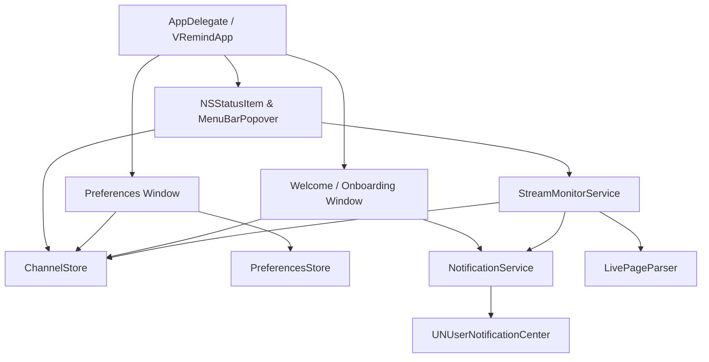

# Design Document: VRemind (macOS VTuber Stream Reminder)

**Date**: 2026-11-11  
**Target Platform**: macOS Monterey (macOS 12.0+)  
**Language/Framework**: Swift 5.9, AppKit, SwiftUI, UserNotifications, ServiceManagement  
**Status**: Approved (Proceeding to Implementation Planning)

---

## 1. Intent and The Why

The goal of **VRemind** is to fork and evolve `CaitlynSwift` from a single-creator fan utility into a production-grade, highly reliable, generic VTuber stream reminder application for macOS. 

The developer is actively "building in public" on Twitter. The app must be polished, stable, and less buggy, serving as a showcase utility. It strips out all Caitlyn-specific entertainment modules (Cait-pedia, Clip Roulette, Replays, and remote JSON config syncing) and elevates the stream monitoring mechanism to a top-tier desktop alert utility that pings native macOS notifications when watched VTubers go live or schedule broadcasts.

---

## 2. Goals, Non-Goals, and Anti-Goals

### Goals
- **Unlimited Watchlist**: Eliminate the legacy 3-slot hardcap. Users can add, inspect, and remove an arbitrary number of VTubers by YouTube `@handle`.
- **Default Example Channel**: Pre-populate Caitlyn Momochi (`@bukancaitlyn`) on fresh installs and factory resets as an editable/removable default example.
- **Native macOS Notifications (`UNUserNotificationCenter`)**:
  - Deliver actionable desktop banner notifications when a VTuber goes live or schedules an upcoming stream.
  - Clicking a notification immediately opens the stream URL in the user's default web browser.
  - Robust deduplication so users receive exactly one notification per broadcast instance.
- **Onboarding / Welcome Experience**:
  - Automatically display a welcome modal on first launch and after a factory reset.
  - Introduce VRemind, prompt for the user's favorite VTuber `@handle` (pre-filled with `@bukancaitlyn`), and request notification permissions upfront.
- **Settings & Preferences Dialog (`⌘,`)**:
  - **General Tab**: Launch at Login toggle (`SMAppService` / `SMLoginItemSetEnabled`) and a "Factory Reset" button with confirmation alert.
  - **Notifications Tab**: Independent toggles for "Notify when live on air", "Notify for upcoming streams / waiting rooms", and notification sound.
  - **About Tab**: Attribution copy: *"VRemind by Caitlyn Momochi, initially vibecoded for their Hackintosh video"* with clickable social media links.
- **Rate-Limited Background Polling**: Fetch channel live pages in polite concurrent batches (pool of 3) every 3 minutes while displays are active; pause polling during display sleep.
- **Production Quality**: Clean separation of concerns, high test coverage for parsers and data management, zero external third-party dependencies, and automated build scripts (`scripts/build-app.sh`).

### Non-Goals
- **Caitlyn Hub Window**: All legacy views (`MainHubView`, `CaitPediaView`, `ReplaysView`, `ClipRouletteView`) and remote config synchronization (`ConfigSyncService`, `caitlyn_hub.json`) are permanently removed.
- **Multi-Platform Support in v1.0**: Focus exclusively on YouTube channel `@handle` monitoring. Twitch or other platforms remain deferred to future updates.
- **Cloud Accounts / Sync**: All watchlist data, notification flags, and preferences are stored strictly locally via `UserDefaults`.

### Anti-Goals
- **Notification Spam**: Must never repeatedly notify every 3-minute poll cycle while a stream remains in progress.
- **UI Freezes**: Network requests, HTML parsing, and thumbnail loading must never block the main thread.
- **Aggressive Scraping**: Must not blast simultaneous parallel requests for large watchlists, risking YouTube HTTP 429 rate limiting.

---

## 3. Constraints

- **Compatibility**: macOS 12.0 (Monterey) and newer, Apple Silicon and Intel universal binary.
- **Frameworks**: Native Apple frameworks only (Foundation, AppKit, SwiftUI, UserNotifications, ServiceManagement, Combine). No external CocoaPods or SPM packages.
- **Tooling**: Must compile cleanly with standard Xcode Command Line Tools (`swift build`, `swift test`).

---

## 4. Approaches Considered

### Approach 1: In-Place Evolution with Git Tag (Selected)
- Tag the current repository at `v1.0-caitlyn-archive` to preserve the original fan companion app in git history.
- Refactor the package directly into `VRemind` / `VRemindKit`.
- Replace legacy models and views with dedicated stores (`ChannelStore`, `PreferencesStore`, `NotificationService`, `StreamMonitorService`).
- **Why chosen**: Fastest route to a production-ready application, reuses tested build/packaging scripts and SPM configuration, and provides a clean transition for pushing to GitHub.

### Approach 2: Clean Sibling Fork (New Directory / Branch)
- Initialize a blank repo in `../VRemind` and cherry-pick code.
- **Trade-off**: Requires recreating build scripts, plists, and test scaffolding from scratch. Rejected as redundant overhead.

---

## 5. Architectural & Technical Specification

### 5.1 Architecture Overview

### 5.2 Core Data Models
- **`WatchedChannel` (`Codable`, `Identifiable`, `Equatable`, `Sendable`)**:
  - `id: String` (normalized lowercased handle, e.g. `"@bukancaitlyn"`)
  - `name: String` (initially defaults to clean handle until resolved from stream/channel metadata)
  - `handle: String` (canonical handle, e.g. `"@bukancaitlyn"`)
  - `avatarURL: URL?`
  - `lastNotifiedVideoId: String?` (tracks deduplication for live alerts)
  - `lastNotifiedUpcomingId: String?` (tracks deduplication for upcoming stream alerts)
  - `lastStreamedAt: Date?` (persisted timestamp of when the channel was last seen live)
  - `lastStreamStatus: StreamStatus?`
- **`StreamStatus` (`Codable`, `Equatable`, `Sendable`)**:
  - `isLive: Bool`
  - `isUpcoming: Bool`
  - `videoId: String?`
  - `title: String`
  - `startedAt: Date?`
  - `scheduledStartTime: Date?`
  - `lastStreamedAt: Date?`
  - `lastCheckedAt: Date`
- **`PreferencesStore` (`ObservableObject`)**:
  - `launchAtLogin: Bool` (defaults to `false`)
  - `notifyOnLive: Bool` (defaults to `true`)
  - `notifyOnUpcoming: Bool` (defaults to `false`)
  - `playNotificationSound: Bool` (defaults to `true`)
  - `hasCompletedOnboarding: Bool` (defaults to `false`)

### 5.3 Service Specifications

#### `ChannelStore`
- Acts as the single source of truth for the watchlist.
- Stored as JSON in `UserDefaults.standard` under key `vremind.watchlist`.
- **Handle Validation & Progressive Metadata Resolution**:
  - Input field performs local regex syntax validation on `@handle`.
  - When added, the channel immediately appears in the list with `name` defaulting to the handle and a placeholder avatar.
  - An immediate background fetch to `/@handle/live` extracts the real channel display name and avatar URL, updating the channel entry in place.
- Methods:
  - `addChannel(handle: String, name: String?, avatarURL: URL?) -> WatchedChannel`
  - `removeChannel(id: String)`
  - `updateStatus(for id: String, status: StreamStatus, notifiedLiveId: String?, notifiedUpcomingId: String?)`
  - `updateMetadata(for id: String, name: String, avatarURL: URL?)`
  - `resetToDefaults()`: Wipes custom channels and re-seeds with Caitlyn Momochi (`@bukancaitlyn`).

#### Onboarding Starter Channel Behavior
- If the user keeps the pre-filled `@bukancaitlyn`, Caitlyn is saved as their initial channel.
- If the user replaces it with their own oshi handle (e.g. `@pekorach`), their chosen handle is saved as the initial channel instead. Users can freely add more channels immediately via the popover.

#### `LaunchAtLoginHelper`
- On macOS 13+ (Ventura and later): Uses `SMAppService.mainApp.register()` / `unregister()`.
- On macOS 12 (Monterey): Uses standard AppleScript `tell application "System Events" to make login item` fallback, avoiding complex nested helper bundles while maintaining Monterey compatibility.

#### `NotificationService`
- Conforms to `UNUserNotificationCenterDelegate`.
- Handles permission request (`requestAuthorization(options: [.alert, .sound, .badge])`).
- Checks system authorization status asynchronously.
- Dispatches notifications:
  - **Live Alert**: Triggered when a channel transitions to live on air.
  - **Upcoming Alert**: If enabled in preferences, triggered once immediately upon discovering a newly scheduled waiting room/premiere (deduplicated by `lastNotifiedUpcomingId`).
  - Title: Channel name.
  - Body: Stream title, with prefix `🔴 LIVE:` or `⏳ UPCOMING:`.
  - UserInfo: `["videoId": videoId, "channelHandle": handle]`.
- Handles user clicking a notification: opens `https://www.youtube.com/watch?v={videoId}` in the default browser.

#### `LivePageParser` (Enhanced)
- Parses `ytInitialPlayerResponse` for:
  - `videoDetails.isLive` / `broadcastDetails.isLiveNow` -> `.live(videoId, title, startedAt)`
  - `videoDetails.isUpcoming` / `broadcastDetails.startTimestamp` -> `.upcoming(videoId, title, scheduledStartTime)`
  - Neither -> `.notLive`
  - Invalid/Unrecognized HTML -> `.unrecognized`

#### `StreamMonitorService`
- Manages 3-minute polling timer.
- Pauses during display sleep (`NSWorkspace.screensDidSleepNotification`) and resumes on wake.
- Concurrency control: Executes requests in batches of 3 using `withTaskGroup` with small inter-batch delays to be polite to YouTube servers.
- Compares parsed result against `lastNotifiedVideoId` / `lastNotifiedUpcomingId` and checks `PreferencesStore` before issuing alerts.

### 5.4 User Interface Specifications

#### A. Menu Bar & Popover
- **Menu Bar Icon**:
  - Offline / Idle: Clean bell or radio symbol (monochrome template).
  - Any Channel Live: Accent-colored live dot or active indicator with optional pulse.
- **Popover**:
  - Header: App title "VRemind", active live count badge, gear icon (opens Preferences), Quit button.
  - Scrollable Channel List:
    - **LIVE NOW** section: Channel avatar, name, stream title, elapsed live duration, click to open.
    - **UPCOMING** section: Channel avatar, name, scheduled time.
    - **OFFLINE** section: Channel avatar, name, last active status, delete button.
  - Bottom Bar: Quick-add text field (`@handle`) + Add button with inline validation.

#### B. Onboarding / Welcome Window
- Modal window presented on first launch (if `!hasCompletedOnboarding`) or after factory reset.
- Welcomes user to VRemind.
- Channel input field pre-filled with `@bukancaitlyn`.
- "Enable Notifications" button showing permission state (Not Determined, Allowed, Denied).
- "Get Started" button: saves channel, requests permission if pending, marks onboarding complete, closes window, and triggers immediate initial status check.

#### C. Preferences Window (`⌘,`)
- Standard native macOS window with 3 tabs:
  1. **General**:
     - Toggle: "Launch VRemind at login".
     - Danger Zone: "Reset All Data to Factory Defaults..." button with alert confirmation modal.
  2. **Notifications**:
     - Checkbox: "Notify when a stream goes live on air" (default: true).
     - Checkbox: "Notify when an upcoming stream / waiting room appears" (default: false).
     - Checkbox: "Play sound with notifications" (default: true).
     - Current permission status indicator with a link to System Settings if disabled.
  3. **About**:
     - App icon and title: "VRemind 1.0".
     - Copy: *"VRemind by Caitlyn Momochi, initially vibecoded for their Hackintosh video."*
     - Clickable links to YouTube channel and Twitter/X profile.

---

## 6. What's Left to the Builder

- Exact microformat fallback paths in `LivePageParser` for edge cases in YouTube responses.
- Visual styling specifics (font sizes, layout padding, SF Symbols choice).
- Unit test suite expansion for `ChannelStore` persistence and deduplication logic.
- Migration cleanup of legacy Caitlyn assets from the repository bundle.
